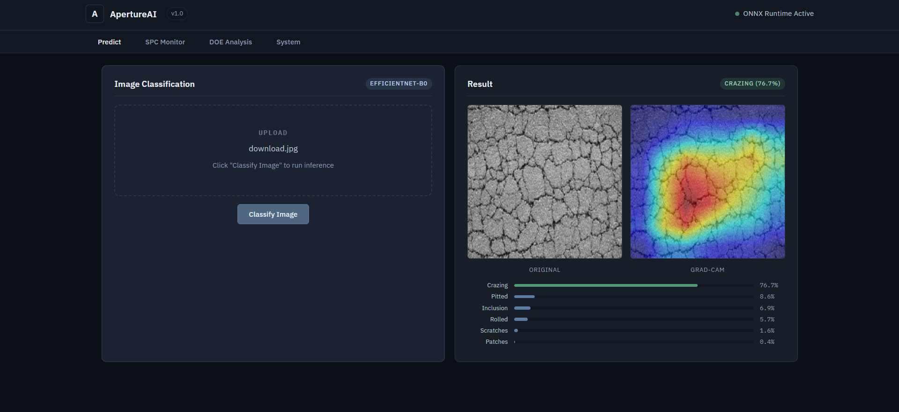
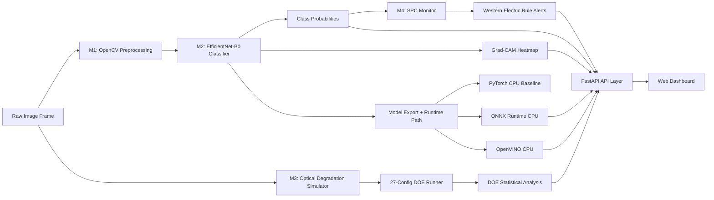

# ApertureAI: Technical Implementation Report

ApertureAI is an end-to-end machine vision system for industrial surface defect inspection.  
This document describes what was implemented, how each subsystem works, and what was achieved.

## 1. Delivered Scope

The implemented system covers five integrated technical modules:

1. OpenCV preprocessing for defect-focused ROI extraction
2. EfficientNet-B0 defect classification with Grad-CAM explainability
3. CPU inference optimization path (PyTorch -> ONNX Runtime -> OpenVINO)
4. Physics-inspired optical degradation simulation with DOE analysis
5. SPC monitoring with Western Electric rule-based drift detection

A FastAPI backend and browser dashboard expose these capabilities for interactive analysis.

## 2. System Architecture

### Architecture rationale

- Preprocessing isolates signal before classification, improving robustness to background texture.
- Classification and explainability are decoupled from runtime optimization, enabling both fast inference and inspection transparency.
- DOE and SPC run as analytic branches that feed the same dashboard and API layer.
- The serving layer standardizes outputs (`predict`, `spc`, `doe`, `metrics`) for consistent consumption.

## 3. Implementation Details

### 3.1 Data validation and split strategy

Implementation:

- `scripts/dataset_audit.py` verifies class balance, image dimensions, and file integrity.
- `src/dataset.py` discovers images across supported naming conventions and performs stratified 70/15/15 train/val/test splits.
- `src/augmentations.py` adds controlled geometric and photometric perturbations to simulate realistic inspection variance.

Technical choices:

- Stratified splitting preserves class proportions across all splits.
- Augmentation avoids transformations that can erase defect evidence (for example, aggressive random crops).

### 3.2 OpenCV preprocessing pipeline (M1)

Implemented in `src/preprocessing.py`.

Pipeline sequence:

1. CLAHE contrast normalization
2. Adaptive Gaussian thresholding
3. Morphological closing then opening
4. Largest contour detection
5. Padded ROI extraction with center-crop fallback
6. Resize + normalization + grayscale-to-3-channel conversion

Why this works:

- CLAHE handles local illumination variation better than global equalization.
- Adaptive thresholding improves segmentation under non-uniform lighting.
- Closing-first morphology preserves thin defect structures while reducing fragmentation.
- Contour-guided ROI avoids fixed-crop failure on off-center defects.

### 3.3 Defect classifier and explainability (M2)

Implemented in `src/model.py`.

Model strategy:

- Base architecture: EfficientNet-B0
- Input adaptation: first conv weights averaged then replicated for grayscale-compatible 3-channel input
- Classifier head replaced with a 6-class linear output

Explainability:

- Grad-CAM hooks are attached to the final convolutional block (`features[8]` in serving path)
- Activation and gradient weighting generate class-localized saliency overlays returned by `/api/predict`

### 3.4 Inference optimization path

Benchmarking implemented in `scripts/benchmark_latency.py`.

Method:

- CPU-only benchmark
- 100 warmup runs
- 1000 timed runs per runtime
- Median latency used as primary comparison metric

Runtimes compared:

- PyTorch (baseline)
- ONNX Runtime
- OpenVINO

### 3.5 Optical simulator + DOE (M3)

Implemented in `src/optical_simulator.py`, `scripts/doe_runner.py`, and `scripts/doe_analysis.py`.

Degradation models:

- PSF blur (Gaussian proxy of diffraction behavior)
- Sensor noise (Poisson + Gaussian)
- Illumination non-uniformity (radial vignette)
- Optional depth-of-field blur

DOE design:

- Full-factorial 3 x 3 x 3 = 27 configurations
- Factors:
  - `psf_sigma`: [1, 3, 6]
  - `snr_db`: [40, 30, 20]
  - `vignette_strength`: [0.0, 0.10, 0.25]
- Output:
  - Per-class F1
  - Macro F1
  - Main effects
  - Interaction heatmap
  - OLS factor significance

### 3.6 SPC monitoring (M4)

Implemented in `src/spc.py` and validated in `scripts/spc_validation.py`.

Control chart logic:

- Batch-level defect rate (`xbar`) and range (`R`) tracking
- Control limit computation (A2-based X-bar and D4-based R-chart constants for n=25)

Western Electric rules implemented:

1. 1 point beyond 3-sigma
2. 9 consecutive points on same side of centerline
3. 6 consecutive monotonic points
4. 2 of 3 consecutive points beyond 2-sigma

### 3.7 Serving and visualization layer

Backend implemented in `app/main.py`:

- `POST /api/predict`
- `GET /api/spc/run-demo`
- `GET /api/doe/results`
- `GET /api/metrics`

Frontend implemented in `app/static/`:

- Tabbed technical dashboard for prediction, SPC behavior, DOE effects, and runtime metrics

## 4. Achievements and Measured Outcomes

### 4.1 KPI summary

| Category | Metric | Achieved |
|---|---|---|
| Classification | Test top-1 accuracy | 99.54% |
| Runtime | PyTorch median CPU latency | 33.21 ms |
| Runtime | ONNX Runtime median CPU latency | 30.37 ms |
| Runtime | OpenVINO median CPU latency | 12.05 ms |
| Runtime | OpenVINO speedup vs PyTorch | 2.76x |
| DOE | Configurations evaluated | 27 |
| DOE | Best / worst macro F1 | 0.9907 / 0.4908 |
| DOE | PSF threshold where macro F1 < 0.90 | sigma = 3 px |
| SPC | False alarm rate | 0% |
| SPC | False escape rate | 0% |
| SPC | Drift detection rate | 100% |

### 4.2 Evidence artifacts

- `results/latency_benchmark.json` (runtime metrics)
- `results/doe_results.csv` (full DOE run table)
- `results/doe_report.md` (effect summaries + OLS)
- `results/main_effects.png` (factor response curves)
- `results/interaction_heatmap.png` (PSF x SNR interaction)
- `results/class_sensitivity.png` (class-level robustness curves)
- `results/spc_validation.json` (SPC validation outcomes)

## 5. How Outcomes Were Achieved

### 5.1 Accuracy and robustness

- Defect-focused preprocessing reduced irrelevant background variation.
- EfficientNet-B0 provided high representational capacity with manageable runtime cost.
- Augmentation introduced realistic process and imaging variation during training.
- Grad-CAM enabled qualitative verification that model attention aligned with defect regions.

### 5.2 Runtime gains

- ONNX and OpenVINO execution paths reduced overhead vs eager PyTorch CPU inference.
- OpenVINO delivered the dominant speedup in this environment (2.76x median vs PyTorch).

### 5.3 Imaging sensitivity insights

- DOE isolated factor contributions across blur, noise, and illumination.
- OLS and main-effects analysis identified PSF blur as the dominant degradation driver.
- A practical threshold emerged at `psf_sigma = 3`, beyond which macro F1 dropped below 0.90.

### 5.4 Process drift detection

- SPC rules capture both abrupt excursions and structured trends.
- Drift injection validation produced zero false escapes in the tested scenario.

## 6. Current Technical Gaps

1. `src/export.py` remains a scaffold for export/validation helper APIs; production artifacts are already present but helper module completion is pending.
2. `scripts/test_predict.py` references an older response schema and should be aligned with current `/api/predict` keys.
3. OpenVINO runtime improved latency substantially, but absolute latency still exceeds the most aggressive original target on current hardware.

## 7. Conclusion

ApertureAI delivers an integrated, technically validated inspection stack that combines computer vision preprocessing, deep classification, runtime optimization, optical DOE-based robustness analysis, and SPC-driven process monitoring. The implementation demonstrates both algorithmic performance and manufacturing-oriented observability under controlled drift and imaging degradation scenarios.
